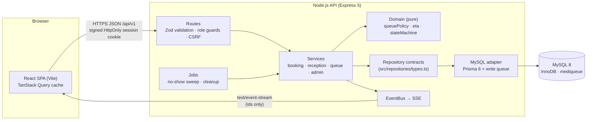
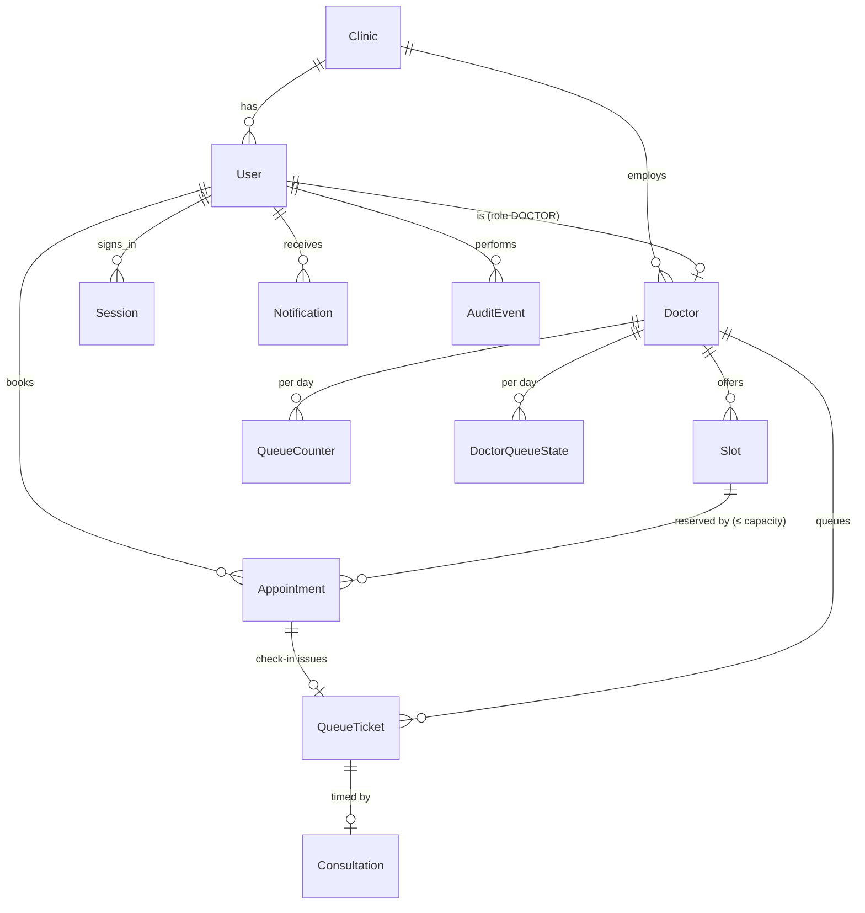
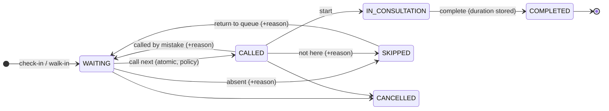
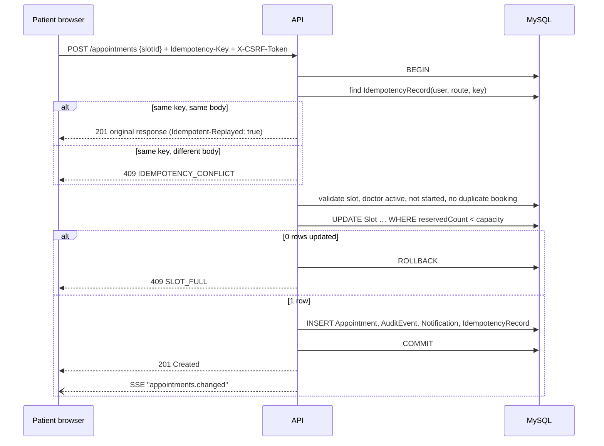

# MediQueue architecture

## 1. Local-first system view



* **Routes** parse HTTP, validate with Zod, check the role, then call a service. The role and identity always come from the server-side session, never from the request body.
* **Services** implement the workflows and own transactions (`store.transaction(fn)`); they depend only on the repository *interfaces*.
* **Domain** functions are pure and unit-tested: the queue selector, ETA engine and state machines. The synthetic simulator reuses them, so the evaluation measures the real algorithm.
* **Adapter**: the only code importing Prisma. Swapping to DynamoDB means writing a new adapter that satisfies the same contracts (with its own access patterns — see `infrastructure/README.md`).
* **Events**: services collect domain events during a transaction and publish them **after commit**. The SSE stream sends only "queue X changed" hints; browsers refetch through authorised endpoints, so no personal data travels on the stream. Polling (5 s) is the fallback.

## 2. Data model



| Integrity rule | Enforced by |
|---|---|
| Never more bookings than capacity | `UPDATE Slot SET reservedCount = reservedCount + 1 WHERE id = ? AND reservedCount < capacity` inside the booking transaction; 0 rows → `409 SLOT_FULL` |
| One token per appointment | `UNIQUE(QueueTicket.appointmentId)` + repeat check-in returns the existing ticket |
| No duplicate token numbers | `QueueCounter` incremented in the same transaction as the ticket insert + `UNIQUE(doctorId, serviceDate, tokenNumber)` |
| One active visit per doctor | `DoctorQueueState.activeTicketId` checked inside the call-next transaction |
| No illegal transitions | Compare-and-set updates: `UPDATE … WHERE id = ? AND status IN (…)` |
| No retry duplicates | `IdempotencyRecord UNIQUE(userId, route, key)` + payload hash |
| Clinic-local days | UTC storage; `serviceDate` computed with `Intl` in the clinic time zone (`Asia/Kolkata`) |

Data lives in MySQL 8 (InnoDB, `utf8mb4`), times as UTC `DATETIME(3)`. Write transactions from the API process also go through an in-process FIFO queue so they never deadlock each other, and a transaction MySQL reports as a deadlock or write conflict (Prisma `P2034`) is retried up to four times. The database guards above remain the source of truth and are exercised by the concurrency tests.

## 3. State machines

```mermaid
stateDiagram-v2
  direction LR
  [*] --> BOOKED: book (capacity guard)
  BOOKED --> CANCELLED: patient (future) / staff (+reason)
  BOOKED --> CHECKED_IN: reception (same day; late → reason)
  BOOKED --> NO_SHOW: after grace period (or override reason)
  CHECKED_IN --> COMPLETED: doctor completes visit
  CHECKED_IN --> CANCELLED: staff (+reason)
  CANCELLED --> [*]
  NO_SHOW --> [*]
  COMPLETED --> [*]
```





## 4. Booking sequence



## 5. Queue policy (blueprint §10)

Only `WAITING` tickets for the doctor and clinic day are eligible.

* Scheduled group order: slot start ↑, check-in ↑, ticket id ↑
* Walk-in group order: check-in ↑, ticket id ↑
* If both groups have candidates and `appointmentStreak < walkInRatio` → next scheduled, `streak += 1`; otherwise → next walk-in, `streak = 0`. If one group is empty, take the other.
* The streak is persisted in `DoctorQueueState`, so the decision is identical across requests and restarts. Paused queues refuse `call-next` (`409 DOCTOR_PAUSED`).
* `predictOrder()` replays the same rule over all waiting tickets; positions and ETAs shown to patients therefore match what the doctor will actually do.
* Nothing in the rule reads symptoms or any clinical attribute.

## 6. Waiting-time estimate (blueprint §10.4)

```
expected   = median(last 5–15 plausible visit durations of this doctor)   else doctor default
remainder  = current visit: max(60 s, expected − elapsed)   |  called-not-started: expected
           ∪ time until the doctor's first slot, if no one has been called yet today
wait(k)    = remainder + k × expected        (k = patients ahead in predicted order)
shown as   [0.8 × wait, 1.25 × wait]   — or "unavailable" when paused
```

The estimate at check-in is snapshotted (`predictedWaitSec`) along with a fixed-12-minute baseline (`baselineWaitSec`) purely for evaluation (MAE on the admin dashboard and in `docs/results/eta-evaluation.md`).

## 7. Security model

| Concern | Implementation |
|---|---|
| Passwords | bcrypt (cost 10) |
| Sessions | 32-byte random token in a signed HttpOnly SameSite=Lax cookie; only its SHA-256 is stored; logout and deactivation delete it server-side |
| CSRF | Double-submit cookie (`mq_csrf`) must equal `X-CSRF-Token` on every non-GET; `Origin` must be the app's own origin or an allow-listed one |
| Authorisation | `requireRole()` per route + ownership checks in services (patients get 404 for others' records) |
| Input | Zod schemas (`.strict()` — unknown fields such as `role` are rejected); 32 KB body limit |
| Abuse | Login/register rate limit (20 per 15 min per IP), general API limit |
| Headers | Helmet with a strict Content-Security-Policy, `X-Powered-By` removed |
| Errors | `{ error: { code, message, requestId } }`; stack traces only in server logs |
| Exports | CSV cells starting with `= + - @` are neutralised; patients appear only as an 8-character reference |
