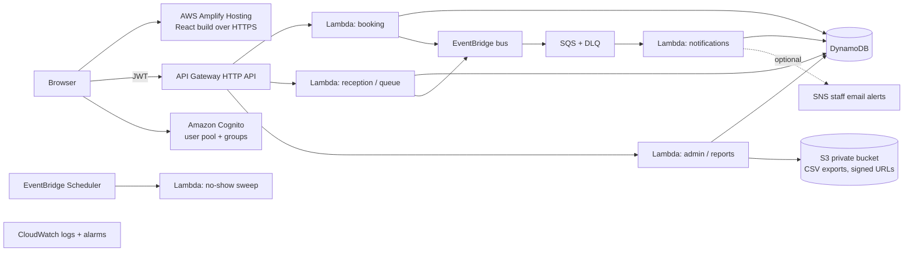

# Future AWS deployment plan

**Status: plan only. Nothing in this repository creates AWS resources, and the application has not been deployed.** The local MySQL build is the complete, tested product; this document describes how it would move to AWS serverless once the local acceptance criteria pass.

## Target architecture

| Local today | AWS later | Notes |
|---|---|---|
| `AuthService` + session cookie | Cognito user pool, groups `PATIENT/RECEPTIONIST/DOCTOR/ADMIN` | Keep the server-side role checks; read the group from the verified JWT, never from the body |
| Express routes | API Gateway HTTP API + Lambda handlers | Same paths (`/api/v1/...`). `createApp` stays for local; Lambda handlers call the same services |
| `src/adapters/mysql` | `src/adapters/dynamodb` implementing `src/repositories/types.ts` | A **redesign**, not a connection-string change (below) |
| `EventBus` → SSE | EventBridge → SQS → notification Lambda; browser polls or uses API Gateway WebSockets | Polling at 5 s is already supported by the frontend |
| `jobs/scheduler.ts` | EventBridge Scheduler (every 1–5 min) | Same `runAutoNoShow()` body |
| CSV response | S3 object + pre-signed URL | Private bucket, lifecycle rule to delete after 7 days |

## DynamoDB access patterns (single-table sketch)

| Access pattern | Key design |
|---|---|
| Open slots for doctor + day | `PK = DOC#<id>#DAY#<date>`, `SK = SLOT#<startIso>` |
| Book a slot (capacity guard) | `TransactWriteItems`: `Update slot SET reserved = reserved + 1 IF reserved < capacity` + `Put APPT` + `Put IDEMP#<user>#<key> IF attribute_not_exists` |
| Patient's appointments | GSI1 `PK = PAT#<id>`, `SK = APPT#<startIso>` |
| Doctor's queue for a day | `PK = DOC#<id>#DAY#<date>`, `SK = TICKET#<token>` |
| Next token | `Update COUNTER item SET last = last + 1` (atomic counter) inside the same transaction as `Put TICKET IF attribute_not_exists` |
| One active visit per doctor | `Update QSTATE IF activeTicketId = :null` in the call-next transaction |
| Ticket by appointment | GSI2 `PK = APPT#<id>` |
| Notifications by user | `PK = USER#<id>`, `SK = NOTE#<createdAt>` |
| Clinic-day analytics | GSI3 `PK = CLINIC#<id>#DAY#<date>` or nightly aggregate item |

The repository contracts were written so each method maps to one of these patterns. Re-run the full concurrency suite against DynamoDB Local before any cloud deployment.

## Migration phases

1. **Cloud A** — Amplify Hosting for the static React build (API still local/staging).
2. **Cloud B** — Cognito; replace cookie sessions with verified JWTs; map groups to roles.
3. **Cloud C** — DynamoDB adapter + transactions; pass the existing tests via DynamoDB Local.
4. **Cloud D** — API Gateway + Lambda handlers; re-run concurrency and integration tests.
5. **Cloud E** — EventBridge/SQS notifications (+ optional SNS staff email).
6. **Cloud F** — S3 exports, CloudWatch alarms, Scheduler, infrastructure as code (AWS SAM).
7. **Cloud G** — cost review, remove unused resources, architecture presentation.

## Cost guardrails

- Check Free Tier eligibility for each service in your own console first; do not assume ₹0.
- One Region, one small environment, synthetic low traffic. No EC2, RDS, NAT gateways or load balancers.
- No SMS. Email via SNS only to verified staff addresses.
- CloudWatch log retention 3–7 days; S3 lifecycle deletion for exports.
- AWS Budgets alerts (they alert; they do not stop charges). Delete the stack after grading (`sam delete`).
